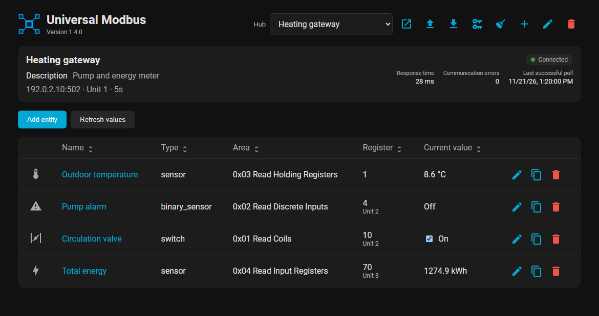
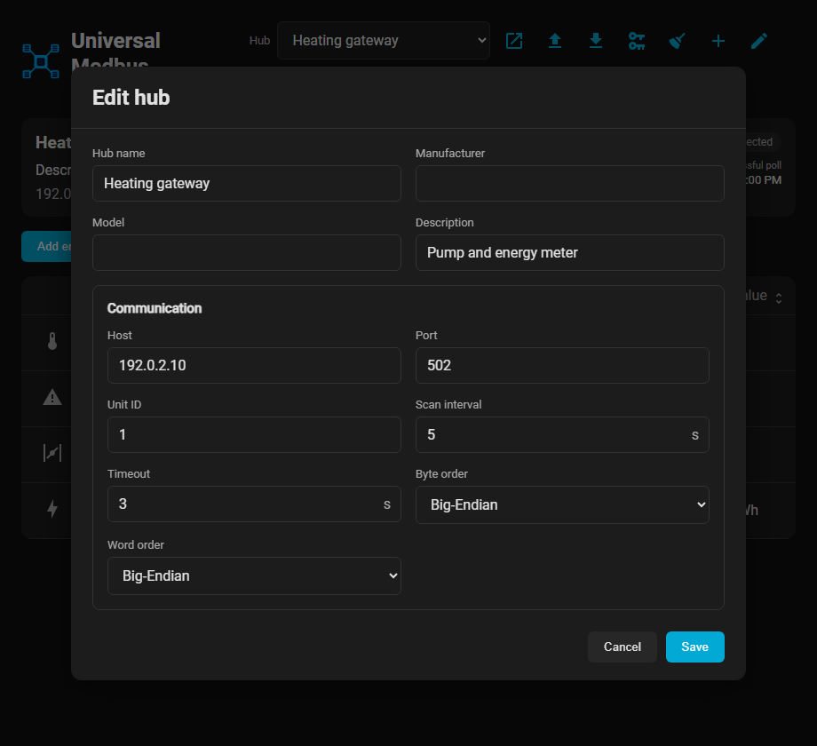
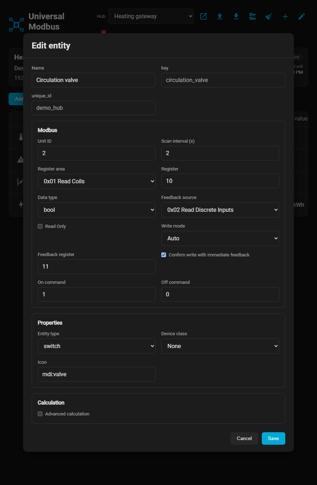

<p align="center">
  
</p>

# Universal Modbus

Universal Modbus is a custom Home Assistant integration for Modbus TCP devices.
Configure connections and entities through the Home Assistant UI.

Universal Modbus is developed and maintained by **Edelmann Electronics**.

## Features

- Create and manage multiple Modbus TCP hubs in the sidebar
- Share a TCP connection across entities on different Unit IDs
- Set how often each entity is polled
- Read coils, discrete inputs, holding registers, and input registers
- Write coils and holding registers
- Create `sensor`, `binary_sensor`, `switch`, `button`, `number`, and `select`
  entities, including pulsed ToggleSwitch entities
- Decode `bool`, `int16`, `uint16`, `int32`, `uint32`, `int64`, `uint64`, and `float32` values
- Configure scaling, offsets, byte order, and word order
- Use safe per-entity read and write formulas for advanced calculations
- Read a separate feedback register immediately to confirm a write
- Write raw holding register values on demand with the `write_register` service
- Display and control entity values directly in the sidebar
- Import and export a complete hub
- Per-hub diagnostic entities for response time, communication errors, last
  successful poll, and device status
- English, German, and Simplified Chinese UI translations

The integration combines overlapping and adjacent reads that share a unit,
register area, and scan interval. A request contains at most 125 registers or
2,000 bits.

## Supported entity types

| Type | Behavior |
| --- | --- |
| `sensor` | Publishes numeric, boolean, or mapped text values. |
| `binary_sensor` | Converts the decoded value to an on/off state. |
| `switch` | Writes configurable on/off values and reports the acknowledged command or the configured feedback state. |
| `toggle_switch` | Sends an on/off pulse whenever its state is changed. |
| `button` | Writes an on value and can optionally send an off value after a configured pulse duration. |
| `number` | Writes numeric values within the configured minimum, maximum, and step. |
| `select` | Maps labels to integer values and writes the selected value. |

Switches, buttons, numbers, and selects can also be configured as read-only.
Writable entities must use a coil or holding register as their write target.

## Installation

Requires Home Assistant 2024.12.0 or later. For release and upgrade details, see
the [changelog](CHANGELOG.md).

### HACS

1. In HACS, open **Integrations**.
2. Open the menu and select **Custom repositories**.
3. Add `https://github.com/Idelmaeaen/HA-Universal-Modbus` as an
   **Integration** repository.
4. Find and download **Universal Modbus**.
5. Restart Home Assistant.

### Manual installation

Copy `custom_components/universal_modbus` into the Home Assistant configuration
directory so that the final path is:

```text
<config>/custom_components/universal_modbus
```

Restart Home Assistant afterward.

## Initial setup

1. Open **Settings > Devices & services** in Home Assistant.
2. Select **Add integration** and search for **Universal Modbus**.
3. Enter the connection settings:

   | Field | Description | Default |
   | --- | --- | --- |
   | Device name | Name of the Home Assistant hub and device | None |
   | Host | Hostname or IP address of the Modbus TCP server | None |
   | Port | TCP port | `502` |
   | Unit ID | Default Modbus unit/slave ID (`0` to `255`) | `1` |
   | Scan interval | Default polling interval in seconds | `5` |
   | Timeout | Connection timeout in seconds | `3` |

Use a port from `1` to `65535` and positive whole seconds for the scan interval
and timeout. Each combination of host, port, and default Unit ID identifies a
hub. Use Unit ID `255` when the device documentation specifies it.

The device must be reachable during setup. If it is unavailable or all
configured reads fail, Home Assistant retries loading the integration.

## Sidebar editor

Open **Universal Modbus** in the Home Assistant sidebar. From there you can:

- Add, edit, select, and delete hubs
- Configure connection details and device metadata
- Add, duplicate, edit, and delete entities
- Sort entities and open their Home Assistant entity pages
- Keep the selected hub when the page is reloaded or opened again
- Scroll the entity table horizontally on narrow mobile screens
- View connection status, response time, communication errors, and the last
  successful poll
- Refresh the displayed values and control writable entities
- Remove orphaned Home Assistant entities

**Settings > Devices & services > Universal Modbus > Configure** links to this
editor.

The upload and download buttons import or export a complete hub as JSON.
Exports omit the host and exporter identity. Enter the host when importing.
The [Kostal KSEM G2 export](profiles/kostal/ksem-g2.json) uses this format.

To replace a hub's profile and entity list while keeping its connection
settings, use **Import profile** in the integration's options and paste the
profile JSON. The [example profile](profiles/example_device.json) uses this
format.

Use **Add entity** above the table. Long entity names wrap, and live value and
diagnostic updates preserve the table while you scroll.

### Screenshots

The screenshots show a gateway with a pump and an energy meter.







## Entity configuration

The editor shows only settings relevant to the selected entity type, register
area, and data type. The most important settings are:

- Name, entity type, icon, and Home Assistant device/state class
- Modbus table and zero-based register address
- Optional Unit ID and scan interval in seconds
- Data type, scale, offset, unit, and displayed decimal places
- Optional advanced read and write formulas
- Optional feedback table and register
- Modbus write mode for writable coils and holding registers
- Write commands and pulse duration for switch-like entities
- Minimum, maximum, and step for numbers
- Value mappings for enum sensors and selects

### Unit IDs and scan intervals

Set the Unit ID and scan interval in the **Modbus** section of the entity
editor. A blank field inherits the corresponding hub default, including in
profiles created before version 1.4.0. Entities with the same effective
interval are polled together.

For a Modbus TCP-to-RTU gateway, create one hub using the gateway's host and
port. Assign the downstream Unit ID to each entity. For example, set a pump's
alarm on Unit ID `2` to poll every `2` seconds and a meter on Unit ID `3` to
poll every `60` seconds. Both use the same TCP connection. The configured Unit
ID applies to reads, writes, and feedback for each entity.

### Entity names

Renaming a register updates the integration's Home Assistant entity name.
Home Assistant name overrides and entity IDs are retained. Entity keys are
generated from the name and stay unchanged during normal edits.
Regenerating keys changes Home Assistant unique IDs and can affect entity IDs,
history, dashboards, and automations.

### Register areas and data types

| Register area | Read function | Access | Supported data types |
| --- | --- | --- | --- |
| Coil | `0x01 Read Coils` | Read/write | `bool` |
| Discrete input | `0x02 Read Discrete Inputs` | Read-only | `bool` |
| Holding register | `0x03 Read Holding Registers` | Read/write | All supported types |
| Input register | `0x04 Read Input Registers` | Read-only | All supported types |

The register-area selectors show these Modbus function names so they can be
matched directly with the terminology used in device documentation. Functions
`0x01` through `0x04` read either one or multiple values, depending on the
requested count; a separate read mode is therefore not required.

`bool`, `int16`, and `uint16` use one bit or register. `int32`, `uint32`, and
`float32` use two registers. `int64` and `uint64` use four registers.

### Addressing and conversion

- Addresses are zero-based and are passed directly to pymodbus. Documentation
  addresses such as `40001` are not converted automatically.
- Register values are calculated as `value = raw value × scale + offset`.
  Writes reverse this calculation before encoding.
- Byte order controls the bytes inside each register. Word order controls the
  registers of a multi-register value. Both settings apply to the complete hub.
- Enum sensors can map raw values to text. Select options map displayed labels
  to integer values.

### Write modes

Writable coil and holding-register entities can select the exact Modbus write
function required by the device documentation:

| Register area | Mode | Function |
| --- | --- | --- |
| Coil | `Auto` | `0x05 Write Single Coil` |
| Coil | `0x05 Write Single Coil` | Write one coil explicitly |
| Coil | `0x0F Write Multiple Coils` | Write a list containing one coil |
| Holding register | `Auto` | `0x06` for one register, `0x10` for multiple registers |
| Holding register | `0x06 Write Single Register` | Write one 16-bit register explicitly |
| Holding register | `0x10 Write Multiple Registers` | Write one or more registers as a list |

`Auto` preserves the behavior of profiles created before version 1.2.0. The
single-register option is unavailable for data types that occupy more than one
register.

### Write feedback

Choose a **Feedback source** and **Feedback register** to read the entity's
state from a different Modbus address on the same unit.
**Confirm write with immediate feedback** is enabled by default for configured
feedback. It reads that register once after the device acknowledges the write,
or after the last command in a pulse. The returned value supplies the entity
state. A failed feedback read reports that the write was acknowledged and that
the state could not be read.

For ordinary writes without immediate confirmation, the acknowledgement
updates the entity with the requested value. Scheduled polling continues on
the configured interval. A pulse with a separate feedback register and
confirmation disabled leaves the feedback state to the next scheduled poll.

### Advanced calculations

Enable **Advanced calculation** in an entity editor to replace the fixed scale
and offset conversion with formulas. Existing entities and entities with the
option disabled continue to use the normal conversion.

The read formula is prefilled with:

```text
register_value * scale + offset
```

`register_value` is the decoded Modbus value after the configured data type,
byte order, and word order have been applied. `scale` and `offset` are the
entity's configured values.

Writable entity types also show a write formula. It converts the Home Assistant
value back to the raw value that is encoded into the register and defaults to:

```text
(value - offset) / scale
```

Formulas are single expressions. They support `+`, `-`, `*`, `/`, `//`, `%`,
comparisons, boolean operators, and conditional expressions. The available
functions are `abs`, `min`, `max`, `round`, `int`, `float`, and `bool`.

Examples:

```text
None if register_value == 65535 else register_value / 10
100 if register_value > 0 else 0
round(max(register_value, 0) * scale + offset, 2)
```

Returning `None` from a read formula creates an unknown value. Formulas are
validated when the profile is saved and run in a restricted evaluator; Python
imports, attributes, indexing, and function definitions are not allowed. If a
read formula fails at runtime, only the affected entity becomes unavailable.

Only administrators should create or import profiles. A profile author is
effectively an administrator: besides formulas, `pulse_ms` can pause a write
for an unrestricted, profile-defined duration. Only use profiles from trusted
sources.

## Services

### Write register

The `universal_modbus.write_register` service writes raw values to holding
registers without a configured entity, similar to Home Assistant's built-in
`modbus.write_register`. Run it from **Settings > Tools > Actions**, or call it
from an automation or script:

```yaml
action: universal_modbus.write_register
data:
  hub: light_modbus_hub
  address: 1
  slave: 1
  value: 1
```

| Field | Required | Description |
| --- | --- | --- |
| `hub` | Yes | Hub name as shown in the integration, or its config entry ID. |
| `address` | Yes | Starting holding register address (`0`–`65535`). |
| `slave` | No | Modbus Unit ID (`0`–`255`). Defaults to the hub's Unit ID and applies only to this write. |
| `value` | Yes | One value (`0`–`65535`) written with FC06, or a list of values written to consecutive registers with FC16. |

The write goes straight to the register: it neither needs nor changes an
entity's state. An explicit `slave` overrides the hub default only for that
command. See the
[service documentation](custom_components/universal_modbus/docs/write_register.md)
for more examples.

## Error handling and diagnostics

If one register read fails, the affected entity becomes unavailable while
other valid entities continue updating. The sidebar shows the current error.
Each hub also provides diagnostic entities for response time, communication
error count, and the last successful poll. These continuous diagnostics stay
out of the Logbook, so polling does not flood the activity panel.

Each hub also has a diagnostic device-status `binary_sensor`: it is on when
communication succeeds and off when the device is offline. It stays available
while offline so the fault state remains visible. Its attributes report
`requests_sent`, `responses_received`, `last_successful_update`, `host`,
`port`, `communication_ok`, `last_error_time`, `last_error`, and
`communication_error_count`.

## Known limitations

- The integration speaks Modbus TCP. A TCP-to-RTU gateway is required for
  serial devices.
- Writes are limited to coils and holding registers.
- Strings, bitfields, and custom encodings are not supported.
- Device discovery is not implemented.
- The editor does not verify whether an address, data type, or command is valid
  for the physical device.
- A writable entity can currently be assigned a read-only table, but the write
  then fails at runtime.
- A scale of `0` is accepted, but cannot be reversed for writes.

## Contributing

Bug reports and focused pull requests are welcome. Include the Home Assistant
and integration versions, entity configuration, Modbus table and address, and
relevant logs when reporting a reproducible issue.

Do not publish credentials, private device registers, or other sensitive data
in exported hubs, logs, issues, or commits.
